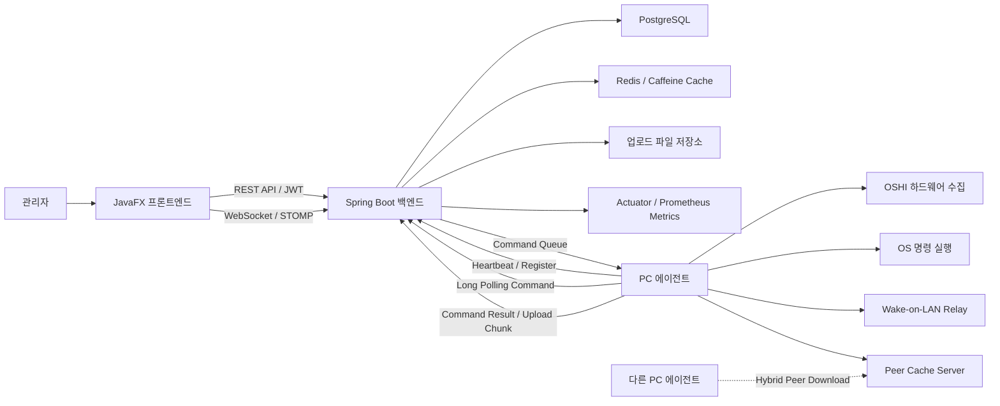
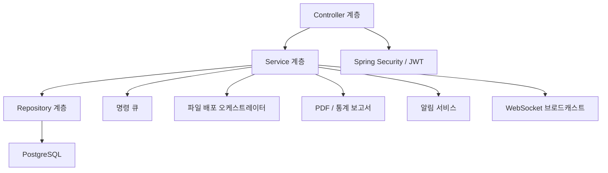
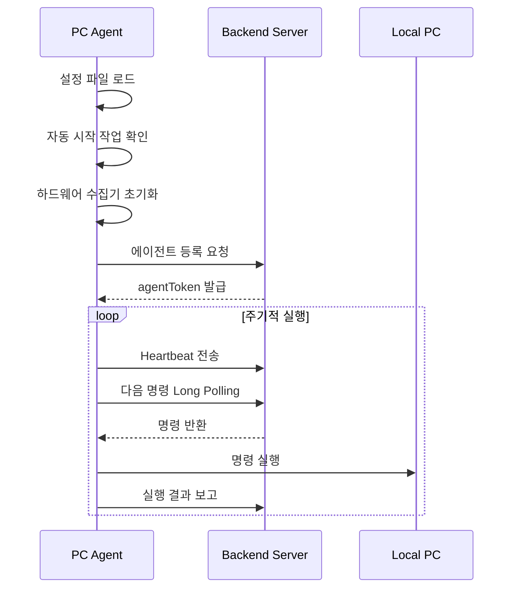

# 과제결과보고서

**[작품명] 통합 PC 관제 및 원격제어 시스템**

- 팀 명 :
- 대 표 학 생 :
- 참 여 학 생 :
- 지 도 교 수 :

---

## 1 작품 개요 및 필요성

### 1.1 작품 개요

본 작품은 강의실 및 실습실에 설치된 다수의 PC를 한 화면에서 관제하고, 원격 명령 실행, 전원 제어, 파일 배포, 장애 표시, 트래픽 모니터링, 보고서 생성을 통합적으로 수행하는 PC 관리 시스템이다.

시스템은 크게 세 부분으로 구성된다.

- **에이전트**: 각 PC에 설치되어 하드웨어 및 네트워크 상태를 수집하고, 서버에서 전달된 명령을 수행한다.
- **백엔드 서버**: 에이전트 등록, 인증, 상태 저장, 명령 큐, 파일 배포, 알림, 보고서 생성을 담당한다.
- **프론트엔드 대시보드**: 관리자가 강의실별 PC 상태를 확인하고, 원격 명령 및 파일 배포를 실행하는 JavaFX 기반 관리 프로그램이다.

에이전트는 PC의 MAC 주소, IP 주소, 호스트명, OS 정보, 네트워크 사용량 등을 주기적으로 서버에 전송한다. 서버는 수집된 정보를 기반으로 PC의 온라인/오프라인 상태, 강의실별 가동 현황, 트래픽 현황, 명령 수행 결과를 관리한다. 관리자는 프론트엔드에서 PC를 선택하여 종료, 재부팅, Wake-on-LAN, 명령 프롬프트 실행, PowerShell 실행, 파일 수집, 파일 배포 등의 작업을 수행할 수 있다.

### 1.2 필요성

학교 실습실처럼 수십 대에서 수백 대의 PC가 운영되는 환경에서는 다음과 같은 관리 문제가 발생한다.

- 각 PC의 전원 및 네트워크 상태를 사람이 직접 확인해야 한다.
- 수업 전후로 PC 종료, 재부팅, 프로그램 설치, 파일 배포 작업을 반복해야 한다.
- 수업이 시작되면 강의실 PC를 켜고, 수업이 끝나면 바로 종료해야 하므로 관리자가 매번 강의실 상태를 확인해야 한다.
- 일부 PC가 절전 상태로 들어가거나 종료 명령 후에도 꺼지지 않는 경우가 있어, 수업 종료 후에도 다시 확인하는 번거로움이 발생한다.
- 특정 PC의 장애 여부나 오프라인 상태를 빠르게 파악하기 어렵다.
- 대용량 파일을 모든 PC에 배포할 때 서버 부하와 네트워크 사용량이 증가한다.
- 운영 이력, 월간 가동률, 트래픽 통계 등을 문서화하는 작업이 수작업으로 이루어진다.

본 작품은 이러한 문제를 해결하기 위해 PC별 에이전트와 중앙 서버를 연결하고, 강의실 단위의 관제 및 원격 관리 기능을 제공한다. 이를 통해 관리자는 물리적으로 PC 앞에 가지 않고도 상태 확인, PC ON/OFF, 명령 실행, 파일 배포, 장애 표시, 보고서 생성을 수행할 수 있다. 특히 수업 시작 전에는 Wake-on-LAN 및 온라인 상태 확인으로 강의실 준비 여부를 확인하고, 수업 종료 후에는 일괄 종료 명령과 오프라인 상태 확인을 통해 꺼지지 않은 PC를 빠르게 찾아낼 수 있다.

---

## 2 작품의 이론 및 기술현황

### 2.1 이론적 근거

본 작품은 클라이언트-서버 구조와 에이전트 기반 관제 방식을 적용하였다.

- **클라이언트-서버 구조**: 백엔드 서버가 중앙에서 인증, 상태 저장, 명령 관리, 파일 배포를 담당하고, 프론트엔드와 에이전트가 서버 API를 통해 통신한다.
- **에이전트 기반 관리**: 관리 대상 PC에 설치된 에이전트가 하드웨어 정보를 수집하고, 서버의 명령을 주기적으로 확인하여 실행한다.
- **Heartbeat 방식**: 에이전트가 일정 주기로 서버에 상태 정보를 전송하여 PC의 온라인 여부를 판별한다.
- **Long Polling 방식**: 에이전트가 서버의 명령 큐를 대기하면서 새 명령을 받아 실행한다.
- **WebSocket/STOMP 방식**: 프론트엔드 대시보드는 서버와 실시간 연결을 유지하여 PC 상태 및 알림 정보를 빠르게 갱신한다.
- **Wake-on-LAN**: 네트워크 상에서 Magic Packet을 전송하여 원격 PC 전원을 켤 수 있도록 한다.
- **JWT 인증**: 관리자 로그인 이후 발급된 토큰으로 백엔드 API 접근 권한을 검증한다.
- **청크 기반 파일 전송**: 파일 업로드, 파일 수집, 에이전트 업데이트에서 큰 파일을 일정 크기 단위로 나누어 전송한다.
- **웨이브 기반 파일 배포**: 전체 PC에 동시에 배포하지 않고 일정 수의 에이전트부터 순차적으로 배포하여 서버 및 네트워크 부하를 줄인다.

### 2.2 기술현황

현재 기업 및 학교 실습실 PC 관리는 상용 원격관리 솔루션, 원격 데스크톱, 수동 배포 스크립트, 이미지 복구 솔루션 등으로 수행되는 경우가 많다. 그러나 실습실 환경에서는 강의실별 PC 상태 확인, 단체 전원 제어, 대용량 파일 배포, 월간 보고서 생성, 장애 PC 표시 등 현장 운영에 맞춘 기능이 함께 필요하다.

본 작품은 Java 기반의 백엔드, JavaFX 기반의 데스크톱 관리 화면, OSHI 기반 하드웨어 수집 에이전트를 하나의 프로젝트로 구성하여 교육기관 실습실 운영에 필요한 기능을 통합하였다. 또한 PostgreSQL, Redis, WebSocket, Prometheus 메트릭, Docker 배포 구성을 포함하여 실제 서버 환경에서 운영 가능한 구조를 갖추었다.

---

## 3 작품의 개발 방법 및 과정

### 3.1 개발 방법

본 작품은 Gradle 멀티 모듈 프로젝트로 구성하였다.

- `backend`: Spring Boot 기반 REST API, WebSocket, 인증, 명령 큐, 파일 배포, 보고서 기능 구현
- `frontend`: JavaFX 기반 관리자 대시보드 구현
- `agent`: 관리 대상 PC에 설치되는 에이전트 구현
- `common`: 공통 DTO 및 공유 모델 관리

Gradle 멀티 모듈 구조를 사용한 이유는 관제 시스템의 역할이 명확히 분리되어 있기 때문이다. 백엔드는 서버 API와 데이터 저장을 담당하고, 프론트엔드는 관리자 화면을 담당하며, 에이전트는 각 PC에서 백그라운드로 동작한다. 세 모듈이 하나의 저장소에서 함께 빌드되기 때문에 공통 DTO를 `common` 모듈로 공유할 수 있고, 에이전트/프론트엔드/백엔드의 API 변경 사항을 한 프로젝트 안에서 함께 관리할 수 있다.

특히 `agent` 모듈은 일반 데스크톱 프로그램과 달리 설치 후 사용자가 직접 조작하지 않아도 계속 동작해야 하므로 별도의 설계가 필요했다. 에이전트는 설치된 PC에서 자동 실행되고, 서버와 주기적으로 통신하며, 서버 명령을 받아 OS 명령 실행, Wake-on-LAN Relay, 파일 수집, 파일 배포, 에이전트 업데이트 등을 수행한다. 또한 대상 PC에 Java가 설치되어 있지 않아도 실행될 수 있도록 `jlink`로 최소 런타임을 만들고, `jpackage`와 WiX 기반 MSI로 설치 패키지를 생성하였다.

개발 과정에서는 실제 운영 흐름을 기준으로 기능을 분리하였다. 먼저 에이전트 등록과 Heartbeat 전송을 구현한 뒤, 서버에서 PC 상태를 저장하고 프론트엔드에서 강의실별 상태를 표시하도록 구성하였다. 이후 수업 전후 운영에 필요한 PC ON/OFF, 원격 명령, 절전 방지, 파일 업로드, 파일 수집, 에이전트 업데이트, 웨이브 배포, 알림, 보고서, 대시보드 레이아웃 관리 기능을 확장하였다.

### 3.1.1 에이전트 구현 기술

에이전트는 관리 대상 PC에 설치되는 핵심 구성 요소로, 사용자가 직접 실행하지 않아도 부팅 후 자동으로 서버에 연결되어야 한다. 이를 위해 다음 기술을 적용하였다.

- **Java 25 기반 독립 실행 구조**: 에이전트는 Java 25로 작성되었고, Gradle `jar` 작업에서 의존성을 포함한 `agent.jar`를 생성한다. JAR Manifest에는 `Main-Class`와 `Implementation-Version`을 기록하여 실행 진입점과 버전을 관리한다.
- **jlink 기반 번들 JRE**: 대상 PC에 Java가 설치되어 있지 않아도 실행되도록 `jlink`로 필요한 Java 모듈만 포함한 런타임을 만든다. 포함 모듈에는 기본 실행 모듈뿐 아니라 파일 전송 UI에 필요한 `java.desktop`, 피어 캐시 서버에 필요한 `jdk.httpserver`, HTTPS 통신 호환성을 위한 `jdk.crypto.ec`가 포함된다.
- **jpackage 및 WiX 기반 MSI**: Windows 배포를 위해 `jpackage`의 MSI 기능을 사용한다. 설치 패키지에는 에이전트 JAR, 설정 파일, 번들 JRE가 포함되며, 설치 후 `PCAgent.exe --first-install` 흐름을 통해 ProgramData 초기화와 자동 시작 등록을 수행한다.
- **Windows 작업 스케줄러 자동 실행**: 에이전트는 부팅 시 SYSTEM 권한으로 실행되도록 Windows 작업 스케줄러에 `PCAgent` 작업을 등록한다. 경로에 공백이 있는 `C:\Program Files` 환경에서도 실행 파일 경로가 잘리지 않도록 PowerShell ScheduledTask API와 `schtasks` fallback을 사용한다.
- **ProgramData 기반 설정 및 로그**: 설치형 에이전트는 `C:\ProgramData\PCAgent` 아래에 설정 파일, 토큰, 로그, 잠금 파일을 관리한다. 사용자 계정이 달라져도 SYSTEM 계정 실행에서 같은 설정을 사용할 수 있도록 하기 위함이다.
- **단일 인스턴스 보장**: `FileChannel`과 `FileLock`을 이용해 `agent.lock` 파일을 배타적으로 잠그고, 중복 실행 시 기존 프로세스만 유지하도록 구성하였다.
- **절전 방지 및 방화벽 보정**: 수업 중 PC가 절전 상태로 들어가거나, 피어 캐시 서버 포트가 막히는 문제를 줄이기 위해 Windows `powercfg`와 `netsh advfirewall` 명령을 사용한다.
- **OSHI 기반 하드웨어 수집**: OSHI 라이브러리를 사용하여 MAC 주소, IP 주소, 호스트명, OS 정보, 네트워크 인터페이스, 송수신 바이트를 수집한다. 서버 통신에 사용할 실제 로컬 IP를 찾기 위해 서버 주소 기준 라우팅도 고려한다.
- **OkHttp 기반 서버 통신**: OkHttp를 사용하여 등록, Heartbeat, 명령 Long Polling, 명령 결과 보고, 파일 업로드/다운로드를 처리한다. TLS 인증서 핀ning 옵션도 두어 HTTPS 환경에서 서버 인증서 검증을 강화할 수 있다.
- **Jackson 기반 JSON 처리**: 서버 API와 주고받는 설정, Heartbeat, 명령, 결과 데이터를 Jackson으로 직렬화/역직렬화한다. Java 날짜/시간 타입 처리를 위해 `jackson-datatype-jsr310`도 사용한다.
- **ExecutorService 기반 명령 처리**: Heartbeat와 명령 실행을 분리하기 위해 명령 실행 전용 스레드 풀을 사용한다. 명령 실행이 오래 걸려도 Heartbeat 흐름이 완전히 멈추지 않도록 하기 위한 구조이다.
- **청크 기반 파일 전송**: 파일 수집과 업데이트 파일 다운로드는 큰 파일을 한 번에 처리하지 않고 청크 단위로 나누어 전송한다. 이를 통해 대용량 파일 배포 시 메모리 사용량과 실패 복구 부담을 줄인다.
- **JDK HttpServer 기반 피어 캐시**: `UpdateCacheServer`는 `com.sun.net.httpserver.HttpServer`를 이용해 에이전트가 받은 업데이트 파일을 같은 네트워크의 다른 에이전트가 받아갈 수 있도록 하는 로컬 피어 캐시 서버 역할을 한다.
- **Logback 기반 파일 로그**: Logback을 사용하여 `C:\ProgramData\PCAgent\logs\agent.log`에 시작 단계, 자동 시작 등록, 서버 통신, 명령 실행, 오류를 기록한다. 현장 PC에서 문제가 발생했을 때 원인 추적을 쉽게 하기 위한 구성이다.

### 3.2 개발 과정

1. **기본 구조 설계**
   - 백엔드, 프론트엔드, 에이전트 모듈을 분리하였다.
   - 에이전트와 서버 간 통신 API를 정의하였다.
   - 관리자 인증과 JWT 기반 API 접근 구조를 구성하였다.

2. **에이전트 등록 및 상태 수집**
   - 설치 키를 이용한 에이전트 등록 기능을 구현하였다.
   - 에이전트 토큰을 로컬 설정 파일에 저장하고 이후 통신에 사용하도록 하였다.
   - MAC 주소, IP 주소, 호스트명, OS 정보, 네트워크 트래픽을 수집하였다.

3. **대시보드 및 강의실 관리**
   - 강의실별 PC 상태, 전체 PC 목록, 온라인 비율, 트래픽 정보를 표시하였다.
   - IP 대역, 그룹, PC 위치, 교사용 장비, 고장 PC 표시 기능을 추가하였다.
   - WebSocket 기반 실시간 갱신과 화면 진입 시 새로고침 흐름을 구성하였다.

4. **원격 명령 기능 구현**
   - 종료, 재부팅, 명령 프롬프트, PowerShell, Wake-on-LAN 명령을 서버에서 큐잉하도록 구현하였다.
   - 에이전트는 명령을 수신한 뒤 실행 결과, 표준 출력, 표준 오류를 서버에 보고한다.
   - 프론트엔드에서는 명령 상태와 결과 상세 내용을 확인할 수 있다.

5. **파일 수집 및 파일 배포**
   - 관리자가 파일을 서버에 업로드하고 대상 PC에 배포할 수 있도록 구현하였다.
   - 에이전트가 PC의 파일 목록을 조회하고, 지정 파일을 서버로 수집하는 기능을 구현하였다.
   - 대용량 파일 전송을 위해 청크 업로드 및 Range 다운로드를 적용하였다.

6. **에이전트 업데이트 및 분산 배포**
   - 에이전트 업데이트 작업을 백엔드에서 Job 단위로 관리하도록 구현하였다.
   - 배포 대상을 웨이브 단위로 나누어 순차적으로 업데이트하도록 구성하였다.
   - 하이브리드 피어 배포 모드에서는 이미 파일을 받은 에이전트를 후보로 활용할 수 있도록 구조를 마련하였다.
   - 실패 임계치와 롤백 명령을 통해 대량 배포 중 위험을 줄일 수 있도록 하였다.

7. **패키징 및 배포**
   - 에이전트는 jlink와 jpackage를 이용해 자체 실행 런타임을 포함한 MSI 설치 파일로 빌드한다.
   - 프론트엔드는 Windows, macOS Intel, macOS ARM64, Linux용 독립 실행 JAR 산출물을 생성한다.
   - 백엔드는 Docker 배포 구성을 통해 서버 환경에 배포할 수 있도록 하였다.

---

## 4 작품 구조도

### 4.1 전체 구조도

### 4.2 백엔드 구조

### 4.3 에이전트 동작 흐름

---

## 5 기대 효과 및 활용 방안

### 5.1 기대 효과

- **관리 효율 향상**: 강의실 PC 상태를 한 화면에서 확인하고 원격 명령을 실행하여 반복 관리 작업을 줄일 수 있다.
- **장애 대응 시간 단축**: 오프라인 PC, 고장 표시 PC, 트래픽 이상 상태를 빠르게 확인할 수 있다.
- **대량 배포 안정성 향상**: 웨이브 기반 배포와 청크 전송을 통해 다수 PC 대상 파일 배포 부담을 줄일 수 있다.
- **운영 기록 확보**: 명령 실행 결과, 에이전트 로그, 월간 보고서, 트래픽 통계를 통해 운영 이력을 관리할 수 있다.
- **교육기관 환경 적합성**: 강의실, IP 대역, 그룹, 교사용 장비 등 실습실 운영에 필요한 단위를 기준으로 관리할 수 있다.

### 5.2 활용 방안

- 컴퓨터공학부 실습실 PC 통합 관리
- 수업 전 PC 전원 상태 확인 및 일괄 Wake-on-LAN 실행
- 수업 자료, 프로그램 설치 파일, 실습 파일의 일괄 배포
- 실습실 PC 장애 현황 및 유지보수 대상 관리
- 월간 PC 가동률 및 네트워크 사용량 보고서 생성
- 향후 원격 화면 제어, 소프트웨어 인벤토리, 보안 점검 기능으로 확장

---

## 6 참여학생 역할 분담표

| 연번 | 성명 | 역할 | 참여도(%) |
| --- | --- | --- | --- |
| 1 |  | 백엔드 API, 인증, 데이터베이스, 명령 큐 구현 |  |
| 2 |  | JavaFX 프론트엔드, 대시보드, PC 관리 화면 구현 |  |
| 3 |  | PC 에이전트, 하드웨어 수집, 원격 명령 실행 구현 |  |
| 4 |  | 파일 배포, 청크 전송, 에이전트 업데이트 구현 |  |
| 5 |  | Docker 배포, 테스트, 문서화 |  |

조기취업자 활동사항:

- 해당 시 작성

---

## 7 제작활동 사진

아래 항목은 최종 제출 시 실제 화면 캡처 또는 제작 사진으로 교체한다.

1. 로그인 화면
2. 전체 대시보드 화면
3. 강의실별 PC 현황 화면
4. PC 원격 명령 실행 화면
5. 파일 업로드 및 배포 진행 화면
6. 에이전트 설치 및 로그 확인 화면
7. 월간 보고서 또는 트래픽 통계 화면

---

## 8 추진일정

| 추진내용 | 1주차(9주차) | 2주차(10주차) | 3주차(11주차) | 4주차(12주차) | 5주차(13주차) | 6주차(14주차) | 7주차(15주차) | 8주차(16주차) |
| --- | --- | --- | --- | --- | --- | --- | --- | --- |
| 과제계획 | O |  |  |  |  |  |  |  |
| 과제선정 | O | O |  |  |  |  |  |  |
| 요구사항 분석 |  | O | O |  |  |  |  |  |
| 백엔드 기본 API 구현 |  |  | O | O |  |  |  |  |
| 에이전트 등록 및 Heartbeat 구현 |  |  | O | O |  |  |  |  |
| 프론트엔드 대시보드 구현 |  |  |  | O | O |  |  |  |
| 원격 명령 및 WOL 구현 |  |  |  |  | O | O |  |  |
| 파일 업로드 및 배포 구현 |  |  |  |  | O | O | O |  |
| 보고서 및 알림 기능 보완 |  |  |  |  |  | O | O |  |
| 패키징 및 배포 테스트 |  |  |  |  |  |  | O | O |
| 최종 문서 작성 |  |  |  |  |  |  |  | O |

---

## 9 지도교수 의견 및 검토사항

최종 제출 시 지도교수 검토 의견을 작성한다.

- 시스템 완성도:
- 실제 실습실 적용 가능성:
- 보완이 필요한 사항:
- 향후 발전 방향:

---

## 10 최종결과물 사진

최종 제출 시 다음 산출물 이미지를 첨부한다.

1. 백엔드 서버 실행 화면 또는 Docker 컨테이너 실행 화면
2. 프론트엔드 대시보드 실행 화면
3. 에이전트 설치 후 로그 생성 화면
4. PC 상태가 서버에 등록된 화면
5. 파일 배포 작업 결과 화면
6. 명령 실행 결과 확인 화면

---

## 11 과제 성과 활용 방안

본 작품은 실습실 운영자가 다수의 PC를 효율적으로 관리하기 위한 내부 운영 도구로 활용할 수 있다. 특히 수업 전 PC 상태 점검, 프로그램 설치 파일 배포, 실습 자료 배포, 수업 후 PC 종료, 장애 PC 표시, 월간 운영 보고서 작성 업무에 직접 적용할 수 있다.

또한 본 작품은 에이전트 기반 관제 구조를 갖추고 있으므로 추후 다음 기능으로 확장할 수 있다.

- 소프트웨어 설치 현황 수집
- 보안 업데이트 상태 점검
- 원격 화면 캡처 또는 원격 지원 기능
- 강의실별 정책 적용
- 배포 작업 예약 기능
- 관리자 UI를 통한 계정 및 비밀번호 변경
- 에이전트 자동 업데이트 안정성 강화

---

# 부록 A. 기능 명세

## A.1 에이전트 기능

| 구분 | 기능명 | 구현 내용 |
| --- | --- | --- |
| 설치 및 실행 | MSI 설치 | jpackage 기반 MSI 설치 파일을 생성하며, 설치 후 ProgramData 경로에 설정과 로그를 관리한다. |
| 설치 및 실행 | 자체 실행 런타임 | jlink로 필요한 Java 런타임 모듈을 포함하여 대상 PC의 Java 설치 상태와 무관하게 실행되도록 구성한다. |
| 설치 및 실행 | 자동 시작 등록 | Windows 예약 작업을 확인하고 에이전트 자동 실행 작업을 등록한다. |
| 설치 및 실행 | 단일 인스턴스 실행 | `C:\ProgramData\PCAgent\agent.lock` 기반으로 중복 실행을 방지한다. |
| 설정 | 설정 파일 로드 | 서버 URL, 설치 키, 에이전트 토큰, 피어 포트 등 에이전트 설정을 로드한다. |
| 설정 | 에이전트 토큰 저장 | 최초 등록 후 서버가 발급한 `agentToken`을 로컬 설정에 저장하여 이후 인증에 사용한다. |
| 등록 | 자동 등록 | 토큰이 없을 경우 설치 키를 이용해 `/api/v1/agent/register`에 등록 요청을 보낸다. |
| 상태 수집 | 하드웨어 정보 수집 | OSHI를 이용해 MAC 주소, IP 주소, 호스트명, OS 정보, 네트워크 인터페이스 정보를 수집한다. |
| 상태 수집 | 네트워크 트래픽 수집 | 인터페이스별 송수신 바이트를 샘플링하고 Heartbeat에 포함한다. |
| 상태 보고 | Heartbeat 전송 | 주기적으로 서버에 상태 정보를 전송하여 온라인 상태를 유지한다. |
| 상태 보고 | 종료 알림 | 에이전트 종료 시 서버에 오프라인 알림을 전송한다. |
| 명령 처리 | 명령 Long Polling | `/api/v1/agent/commands/next` API를 통해 서버 명령을 대기한다. |
| 명령 처리 | 명령 ACK | 명령 수신 후 ACK를 서버에 보고한다. |
| 명령 처리 | 명령 결과 보고 | 명령 실행 결과, 표준 출력, 표준 오류, 종료 코드를 서버에 보고한다. |
| 원격 제어 | PC 종료 | 서버 명령에 따라 로컬 PC 종료 명령을 실행한다. |
| 원격 제어 | PC 재부팅 | 서버 명령에 따라 로컬 PC 재부팅 명령을 실행한다. |
| 원격 제어 | CMD 실행 | 서버에서 전달한 명령 프롬프트 명령을 실행한다. |
| 원격 제어 | PowerShell 실행 | 서버에서 전달한 PowerShell 스크립트 또는 명령을 실행한다. |
| 원격 제어 | Wake-on-LAN Relay | 같은 네트워크 대역에 Magic Packet을 전송하여 대상 PC 전원을 켠다. |
| 파일 관리 | 파일 목록 조회 | 대상 PC의 파일 및 폴더 목록을 조회하여 서버에 반환한다. |
| 파일 관리 | 파일 수집 | 지정 파일을 청크 단위로 서버에 업로드한다. |
| 파일 관리 | 에이전트 업데이트 | 서버에서 업데이트 파일을 내려받아 에이전트 업데이트 작업을 수행한다. |
| 파일 관리 | 청크 다운로드 | 대용량 다운로드 시 8MB 단위 청크 다운로드 흐름을 사용한다. |
| 피어 배포 | 피어 캐시 서버 | 파일 배포 시 다른 에이전트가 내려받을 수 있는 로컬 캐시 서버를 실행할 수 있다. |
| 보안 | TLS Pinning 옵션 | `AGENT_TLS_PIN_SHA256` 설정을 통해 서버 인증서 핀 검증을 선택적으로 적용할 수 있다. |
| 로그 | 로그 파일 기록 | `C:\ProgramData\PCAgent\logs\agent.log`에 시작 단계, 등록, 통신, 오류 정보를 기록한다. |

## A.2 백엔드 기능

| 구분 | 기능명 | 구현 내용 |
| --- | --- | --- |
| 인증 | 관리자 로그인 | `/api/v1/auth/login` API를 통해 관리자 로그인을 처리하고 JWT를 발급한다. |
| 인증 | JWT 보호 API | Spring Security 기반으로 관리자 API 접근을 제어한다. |
| 사용자 관리 | 사용자 CRUD | 관리자 계정 생성, 조회, 수정, 삭제 API를 제공한다. |
| 사용자 관리 | 비밀번호 변경 | 관리자 비밀번호 변경 API를 제공한다. |
| 에이전트 관리 | 에이전트 등록 | 설치 키 기반으로 에이전트 등록을 처리하고 토큰을 발급한다. |
| 에이전트 관리 | 등록 상태 조회 | 에이전트 등록 상태 조회 및 변경 API를 제공한다. |
| 에이전트 관리 | 에이전트 목록 | 등록된 에이전트 목록과 상태를 조회한다. |
| 에이전트 관리 | 에이전트 삭제 | 관리자 API로 에이전트를 삭제할 수 있다. |
| 상태 관리 | Heartbeat 처리 | 에이전트 Heartbeat를 저장하고 온라인 상태를 갱신한다. |
| 상태 관리 | 오프라인 알림 | 에이전트 종료 또는 미응답 상태를 바탕으로 오프라인 알림을 처리한다. |
| 대시보드 | 전체 요약 | 전체 PC, 온라인 PC, 강의실별 상태 요약 정보를 제공한다. |
| 대시보드 | 강의실별 PC 조회 | 강의실별 PC 목록과 상태를 조회한다. |
| 대시보드 | 트래픽 조회 | PC별, 강의실별 네트워크 트래픽 정보를 조회한다. |
| 대시보드 | 실시간 갱신 | WebSocket/STOMP로 대시보드 상태 변경을 프론트엔드에 전달한다. |
| 강의실 관리 | IP 대역 관리 | IP 대역 목록, 생성, 일괄 저장, 삭제 기능을 제공한다. |
| 강의실 관리 | 그룹 관리 | 그룹 생성, 수정, 삭제, IP 기반 자동 배정, MAC 기반 수동 배정 기능을 제공한다. |
| 강의실 관리 | PC 위치 관리 | 대시보드에서 사용하는 PC 위치 정보를 저장한다. |
| 강의실 관리 | 교사용 장비 관리 | 교사용 장비 정보를 등록하고 조회한다. |
| 장애 관리 | 고장 PC 표시 | 고장 PC 등록, 조회, 수정, 삭제 기능을 제공한다. |
| 명령 관리 | 명령 생성 | 특정 에이전트 또는 IP 대상 명령을 생성한다. |
| 명령 관리 | 명령 큐 | 에이전트가 가져갈 명령을 큐 형태로 관리한다. |
| 명령 관리 | 명령 ACK/결과 | 에이전트의 명령 수신 및 실행 결과를 저장한다. |
| 명령 관리 | 명령 이력 조회 | 명령 목록과 실행 상태를 조회한다. |
| 파일 관리 | 파일 업로드 | 관리자가 배포할 파일을 서버에 업로드한다. |
| 파일 관리 | 청크 업로드 | 대용량 파일을 청크 단위로 업로드하고 조립한다. |
| 파일 관리 | Range 다운로드 | 에이전트가 파일을 부분 다운로드할 수 있도록 Range 응답을 제공한다. |
| 파일 관리 | 에이전트 수집 파일 다운로드 | 에이전트가 업로드한 수집 파일을 관리자가 다운로드할 수 있다. |
| 파일 배포 | 배포 Job 생성 | 업로드 파일과 대상 에이전트를 기준으로 배포 작업을 생성한다. |
| 파일 배포 | 웨이브 실행 | 대상 에이전트를 웨이브 단위로 나누어 순차적으로 배포한다. |
| 파일 배포 | 실패 재시도 | 실패한 에이전트에 대해 재시도 명령을 생성한다. |
| 파일 배포 | 배포 취소 | 전체 Job 또는 특정 Wave를 취소한다. |
| 파일 배포 | 롤백 | 실패 임계치 초과 시 롤백 명령을 생성할 수 있다. |
| 파일 배포 | 하이브리드 피어 | 서버 다운로드와 에이전트 피어 다운로드 후보를 함께 관리한다. |
| 알림 | 알림 목록 | 알림 목록, 미확인 개수, 확인 처리 API를 제공한다. |
| 보고서 | 월간 보고서 | 월간 운영 통계를 조회하고 PDF 보고서를 생성한다. |
| 보고서 | 트래픽/가동률 데이터 | 트래픽 JSON, 가동률 JSON 데이터를 제공한다. |
| 리소스 관리 | 대시보드 레이아웃 | 대시보드, 패널, 레이아웃 백업 및 복원 기능을 제공한다. |
| 리소스 관리 | 위젯 리소스 | 텍스트, 이미지, 업로드 파일 기반 대시보드 위젯을 관리한다. |
| 운영 | 감사 로그 | 관리자 작업에 대한 감사 로그 조회 기능을 제공한다. |
| 운영 | 메트릭 | Spring Actuator와 Prometheus 메트릭을 제공한다. |

## A.3 프론트엔드 기능

| 구분 | 기능명 | 구현 내용 |
| --- | --- | --- |
| 인증 | 로그인 화면 | 서버 로그인 API를 호출하고 JWT 토큰을 저장한다. |
| 인증 | 세션 처리 | 인증 실패, 토큰 만료, 서버 오류 메시지를 사용자에게 표시한다. |
| 대시보드 | 전체 현황 | 전체 PC 수, 온라인 PC 수, 강의실별 상태를 표시한다. |
| 대시보드 | 실시간 갱신 | WebSocket/STOMP 연결과 주기 갱신을 통해 최신 상태를 반영한다. |
| 대시보드 | 화면 진입 새로고침 | 주요 화면으로 이동할 때 데이터를 다시 조회한다. |
| 강의실 현황 | 강의실 목록 | 강의실별 PC 상태와 온라인 비율을 표시한다. |
| 강의실 현황 | PC 그리드 | PC 위치 및 상태를 그리드 형태로 표시한다. |
| PC 관리 | 전체 PC 목록 | 등록된 PC를 검색, 필터링, 선택할 수 있다. |
| PC 관리 | 선택 명령 실행 | 선택한 PC에 종료, 재부팅, WOL, CMD, PowerShell 명령을 보낸다. |
| PC 관리 | IP 대상 명령 | IP 주소 기준으로 명령을 전송할 수 있다. |
| PC 관리 | 원격 파일 탐색 | 에이전트의 파일 목록 조회 명령을 실행하고 결과를 표시한다. |
| PC 관리 | 파일 수집 | 에이전트 PC의 파일을 서버로 수집하도록 명령한다. |
| PC 관리 | 파일 배포 | 로컬 파일을 서버에 업로드하고 대상 PC에 배포한다. |
| PC 관리 | 업로드 진행률 | 프론트엔드에서 서버로 업로드되는 진행률과 결과를 표시한다. |
| 에이전트 배포 | 업데이트 파일 선택 | 에이전트 업데이트 파일을 선택하여 배포 작업을 생성한다. |
| 에이전트 배포 | 웨이브 설정 | 배포 웨이브 크기, 증가율, 실패 임계치 등 배포 옵션을 설정한다. |
| 에이전트 배포 | 진행 상태 확인 | 배포 Job, Wave, 대상별 성공/실패 상태를 확인한다. |
| 명령 상태 | 명령 목록 | 실행한 명령 목록과 상태를 조회한다. |
| 명령 상태 | 상세 결과 | 명령 표준 출력, 표준 오류, 종료 코드, 결과 파일을 확인한다. |
| 네트워크 | 트래픽 차트 | 강의실 및 PC별 네트워크 트래픽을 차트와 표로 표시한다. |
| 네트워크 | 출력/내보내기 | 트래픽 정보를 화면 출력 또는 파일 내보내기 형태로 활용한다. |
| 관리 | IP 대역 관리 | 강의실별 IP 대역을 등록하고 수정한다. |
| 관리 | 그룹 관리 | PC 그룹과 배치 정보를 관리한다. |
| 관리 | 교사용 장비 관리 | 교사용 장비 목록을 관리한다. |
| 관리 | 고장 PC 관리 | 고장 PC 표시와 메모를 관리한다. |
| 관리 | 설치 키 확인 | 에이전트 설치에 필요한 설치 키 정보를 확인한다. |
| 관리 | 에이전트 목록 관리 | 등록된 에이전트 목록을 확인하고 삭제할 수 있다. |
| 알림 | 알림 팝업 | 백엔드 알림을 배지와 팝업으로 표시한다. |
| 알림 | 알림 필터 | 알림 표시 필터 설정을 제공한다. |
| 보고서 | 월간 보고서 | 백엔드 월간 보고서 API를 호출하여 결과를 확인한다. |
| 리소스 | 대시보드 위젯 | 텍스트, 이미지, 파일 기반 위젯을 관리한다. |

## A.4 공통 및 배포 기능

| 구분 | 기능명 | 구현 내용 |
| --- | --- | --- |
| 공통 | DTO 공유 | `common` 모듈을 통해 프론트엔드와 백엔드가 공유하는 데이터 모델을 관리한다. |
| 빌드 | Gradle 멀티 모듈 | `backend`, `frontend`, `agent`, `common` 모듈을 하나의 Gradle 프로젝트에서 관리한다. |
| 배포 | Docker 배포 | 백엔드 서버를 Docker 환경에 배포할 수 있는 설정을 제공한다. |
| 배포 | 에이전트 MSI | Windows PC에 설치 가능한 에이전트 MSI 산출물을 생성한다. |
| 배포 | 플랫폼별 프론트 JAR | Windows, macOS Intel, macOS ARM64, Linux용 프론트엔드 독립 실행 JAR을 생성한다. |
| 설정 | 환경 변수 기반 설정 | DB, Redis, JWT, 업로드 용량, 파일 배포 설정 등을 환경 변수로 제어한다. |

---

# 부록 B. 기술 스택 및 사용 기술

## B.1 백엔드 기술 스택

| 항목 | 사용 기술 |
| --- | --- |
| 언어 | Java 25 |
| 프레임워크 | Spring Boot 4.0.5 |
| 웹 API | Spring Web, REST Controller |
| 보안 | Spring Security, JWT |
| 데이터 접근 | Spring Data JPA, Hibernate |
| 데이터베이스 | PostgreSQL, SQLite JDBC 지원 |
| 마이그레이션 | Flyway |
| 캐시 | Redis, Caffeine Cache |
| 실시간 통신 | Spring WebSocket, STOMP |
| 검증 | Spring Validation |
| 메일 | Spring Mail |
| 모니터링 | Spring Actuator, Micrometer, Prometheus Registry |
| PDF 생성 | iText 7, Apache PDFBox 테스트 의존성 |
| API 문서 | SpringDoc OpenAPI |
| 설정 | dotenv-java, Spring `application.yml` |
| 테스트 | JUnit Platform, Spring Boot Test, Spring Security Test, ByteBuddy |
| 빌드 | Gradle |

## B.2 프론트엔드 기술 스택

| 항목 | 사용 기술 |
| --- | --- |
| 언어 | Java 25 |
| UI 프레임워크 | JavaFX 25.0.2 |
| JavaFX 모듈 | Controls, FXML, Web, Swing, Graphics |
| UI 라이브러리 | ControlsFX, AtlantaFX |
| 아이콘 | Ikonli MaterialDesign2 |
| HTTP/JSON | Java HttpClient 계열 API, Jackson Databind |
| WebSocket | Spring Messaging, Spring WebSocket, Tyrus Client, Jakarta WebSocket API |
| 로깅 | SLF4J, Logback |
| 테스트 | JUnit Jupiter, TestFX |
| 패키징 | Gradle Shadow, 플랫폼별 실행 JAR 생성 |

## B.3 에이전트 기술 스택

| 항목 | 사용 기술 |
| --- | --- |
| 언어 | Java 25 |
| 빌드/패키징 | Gradle `java`, `application`, 커스텀 `buildJre`, `deployPackage`, `jpackageMsi` 작업 |
| 실행 산출물 | 의존성을 포함한 `agent.jar`, jlink 번들 JRE, jpackage MSI |
| 시스템 정보 수집 | OSHI 6.4.13. MAC 주소, IP 주소, OS 정보, 네트워크 인터페이스, 트래픽 카운터 수집에 사용 |
| HTTP 클라이언트 | OkHttp 4.12.0. 에이전트 등록, Heartbeat, Long Polling, 명령 결과 보고, 파일 업로드/다운로드에 사용 |
| HTTPS 보안 | OkHttp `CertificatePinner`. 선택적으로 TLS 인증서 핀 검증을 적용할 수 있도록 구성 |
| JSON 처리 | Jackson Databind 2.17.1, Jackson JSR310. 설정 파일, 명령 payload, Heartbeat, API 응답 직렬화/역직렬화에 사용 |
| 로깅 | SLF4J, Logback 1.5.6. ProgramData 하위 `agent.log` 파일 기록과 콘솔 로그에 사용 |
| 동시성 처리 | `ExecutorService`, `ScheduledExecutorService`. Heartbeat 스케줄링, 트래픽 샘플링, 명령 병렬 실행에 사용 |
| 단일 실행 제어 | Java NIO `FileChannel`, `FileLock`. `agent.lock` 파일 기반 중복 실행 방지 |
| 명령 실행 | `ProcessBuilder`, Windows CMD, PowerShell, OS 프로세스 실행. 종료, 재부팅, CMD/PS1 실행, MSI 업데이트 설치에 사용 |
| 전원 관리 | Windows `powercfg`. 수업 중 절전/최대절전으로 들어가는 문제를 줄이기 위해 사용 |
| 방화벽 설정 | Windows `netsh advfirewall`. 서버 통신 및 피어 캐시 포트 허용 규칙 등록에 사용 |
| Wake-on-LAN | UDP Magic Packet 전송. 꺼진 PC를 같은 네트워크의 온라인 에이전트가 깨우는 Relay 기능에 사용 |
| 파일 전송 | 청크 업로드, Range 다운로드, ZIP 압축/해제. 파일 수집, 대용량 배포, 에이전트 업데이트에 사용 |
| 피어 캐시 | JDK `HttpServer` (`jdk.httpserver`). 업데이트 파일을 받은 에이전트가 같은 대역의 다른 에이전트에 파일을 제공하는 데 사용 |
| UI 보조 | Java Desktop/Swing. 에이전트 파일/폴더 전송 진행 상태와 선택 UI에 사용 |
| 보안 유틸 | 민감정보 마스킹, Zip Slip/Zip Bomb 방지 로직. 로그와 압축 해제 과정의 위험을 줄이는 데 사용 |
| 패키징 | `jlink`, `jpackage`, WiX Toolset. Java 미설치 PC에서도 실행 가능한 Windows MSI 설치 파일 생성 |
| 테스트 | JUnit Jupiter, AssertJ, Mockito |

에이전트에서 중요한 라이브러리는 OSHI, OkHttp, Jackson, Logback이다. OSHI는 운영체제별 하드웨어 정보를 직접 다루는 복잡도를 줄여 주고, OkHttp는 안정적인 HTTP 통신과 Long Polling 구현에 사용된다. Jackson은 서버와 주고받는 JSON 구조를 객체로 안전하게 다루기 위해 사용하며, Logback은 다른 PC에서 문제가 발생했을 때 `agent.log`만 확인해도 시작 단계, 자동 시작 등록, 서버 등록, 명령 처리 오류를 추적할 수 있도록 한다.

또한 에이전트는 별도의 Spring Boot 애플리케이션으로 만들지 않았다. 관리 대상 PC마다 상시 실행되어야 하므로 실행 크기와 시작 속도, 설치 안정성이 중요했고, Java 표준 라이브러리와 필요한 외부 라이브러리만 포함하는 경량 구조가 더 적합했다. 대신 `jlink`와 `jpackage`를 활용하여 Java 런타임과 애플리케이션을 함께 배포함으로써, PC마다 Java 버전이 달라도 동일한 방식으로 실행되도록 구성하였다.

## B.4 인프라 및 운영 기술

| 항목 | 사용 기술 |
| --- | --- |
| 컨테이너 | Docker, Docker Compose |
| 운영 DB | PostgreSQL |
| 캐시/상태 보조 | Redis |
| 파일 저장 | 서버 로컬 업로드 디렉터리 |
| 로그 | 백엔드 로그, 에이전트 `agent.log` |
| 설정 관리 | `.env`, 환경 변수, Spring 설정 |
| 배포 산출물 | 백엔드 JAR, 프론트엔드 플랫폼별 JAR, 에이전트 MSI |

---

# 부록 C. 주요 산출물

| 산출물 | 설명 |
| --- | --- |
| `backend/build/libs/backend-0.0.1-SNAPSHOT.jar` | 백엔드 서버 실행 JAR |
| `dist/frontend/frontend-win.jar` | Windows용 프론트엔드 실행 JAR |
| `dist/frontend/frontend-mac.jar` | macOS Intel용 프론트엔드 실행 JAR |
| `dist/frontend/frontend-mac-aarch64.jar` | macOS Apple Silicon용 프론트엔드 실행 JAR |
| `dist/frontend/frontend-linux.jar` | Linux용 프론트엔드 실행 JAR |
| `dist/msi/PCAgent-1.1.8.msi` | Windows용 PC 에이전트 설치 MSI |
| `deploy/docker-compose.yml` | 서버 배포용 Docker Compose 설정 |
| `deploy/Dockerfile` | 백엔드 Docker 이미지 빌드 설정 |

---

# 부록 D. 코드 기준 확인 파일

본 문서는 다음 구현 파일과 설정을 기준으로 작성하였다.

| 구분 | 파일 |
| --- | --- |
| 프로젝트 모듈 | `settings.gradle` |
| 백엔드 빌드 | `backend/build.gradle` |
| 백엔드 설정 | `backend/src/main/resources/application.yml` |
| 인증 API | `backend/src/main/java/com/example/backend/controller/auth/AuthController.java` |
| 에이전트 등록 API | `backend/src/main/java/com/example/backend/controller/agent/AgentController.java` |
| 명령 API | `backend/src/main/java/com/example/backend/controller/command/CommandController.java` |
| 대시보드 API | `backend/src/main/java/com/example/backend/controller/dashboard/DashboardController.java` |
| 파일 API | `backend/src/main/java/com/example/backend/controller/script/ScriptController.java` |
| 파일 배포 API | `backend/src/main/java/com/example/backend/controller/filedist/FileDistributionController.java` |
| 파일 배포 오케스트레이션 | `backend/src/main/java/com/example/backend/service/filedist/FileDistributionOrchestrator.java` |
| 보고서 API | `backend/src/main/java/com/example/backend/controller/report/ReportController.java` |
| 프론트엔드 빌드 | `frontend/build.gradle` |
| 프론트엔드 시작점 | `frontend/src/main/java/com/example/frontend/DashboardApp.java` |
| 프론트엔드 API 클라이언트 | `frontend/src/main/java/com/example/frontend/service/ApiClient.java` |
| 프론트엔드 대시보드 | `frontend/src/main/java/com/example/frontend/controller/DashboardController.java` |
| PC 관리 화면 | `frontend/src/main/java/com/example/frontend/controller/dashboard/DashboardPcManagementModule.java` |
| 명령 상태 화면 | `frontend/src/main/java/com/example/frontend/controller/panel/CommandStatusPanelController.java` |
| 네트워크 화면 | `frontend/src/main/java/com/example/frontend/controller/panel/NetworkTabController.java` |
| 에이전트 빌드 | `agent/build.gradle` |
| 에이전트 시작점 | `agent/src/main/java/com/example/agent/AgentMain.java` |
| 에이전트 상태 수집 | `agent/src/main/java/com/example/agent/hardware/HardwareCollector.java` |
| 에이전트 통신 | `agent/src/main/java/com/example/agent/heartbeat/HeartbeatSender.java` |
| 에이전트 명령 실행 | `agent/src/main/java/com/example/agent/command/CommandExecutor.java` |
| 에이전트 피어 캐시 | `agent/src/main/java/com/example/agent/update/UpdateCacheServer.java` |
