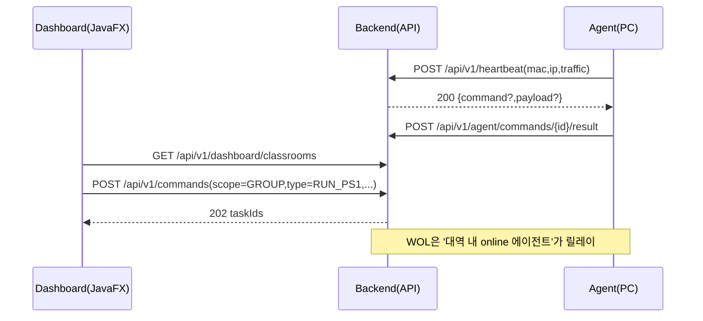

## 목표

- **강의실별 패널 1개씩**: 교사PC/학생PC 상태(ONLINE/OFFLINE), 하트비트 최신시각, 트래픽 요약(실시간/기간), PC 목록을 한 패널에 표시
- **대역 등록 기반 자동 매핑**: 강의실에 하나 이상의 IP 대역(CIDR 또는 start-end)을 등록하고, 하트비트로 올라온 PC를 해당 강의실로 자동 귀속
- **교사PC/학생PC 구분**: 대역 내에서 교사PC는 별도 IP/MAC 목록으로 지정(나머지는 학생PC로 처리)
- **단일/일괄 제어**: PC 종료/재부팅, WOL(매직패킷), 명령 실행, PS1 파일 전송 및 실행을 “한 번에”
- **릴레이 WOL**: 해당 대역(또는 강의실)에 최소 1대 에이전트가 켜져 있으면 그 에이전트가 매직패킷을 전달

## 현재 상태(기반 코드)

- 하트비트: `POST /api/v1/heartbeat`가 `pc_master`, `client_positions`, `traffic_logs`, `command_queue`를 갱신/소비
  - `backend/src/main/java/com/example/backend/controller/HeartbeatController.java`
  - `backend/src/main/java/com/example/backend/dto/HeartbeatDto.java`
- 강의실 그룹: `GET/POST/PUT/DELETE /api/v1/groups` 및 수동 할당(현재는 IP/MAC로 수동)
  - `backend/src/main/java/com/example/backend/controller/GroupController.java`
- 트래픽: 하트비트의 `traffic`로 `traffic_logs` 적재 + PDF 리포트
  - `backend/src/main/java/com/example/backend/service/TrafficService.java`
  - `backend/src/main/java/com/example/backend/service/ReportService.java`
- 명령 큐: `command_queue`에 enqueue → 다음 하트비트 응답으로 1건 전달 후 executed 처리
  - `backend/src/main/java/com/example/backend/model/CommandQueue.java`
  - `backend/src/main/java/com/example/backend/controller/AdminController.java`
- 프론트: JavaFX가 `GET /api/v1/groups`로 그룹별 Pane을 만들고, positions/modules를 렌더링
  - `frontend/src/main/java/com/example/frontend/controller/DashboardController.java`

## 설계(권장 아키텍처)

### 1) 에이전트(Windows 서비스) 역할

- 주기적으로 `POST /api/v1/heartbeat` 전송(현행 유지)
- 서버가 내려준 **Command**(명령/PS1 실행/종료/재부팅/WOL 릴레이)를 로컬에서 실행
- 실행 결과(성공/실패/출력/종료코드)를 서버로 **ACK/Result 업로드**

### 2) 서버(백엔드) 책임

- 강의실/대역/교사PC 식별 데이터 관리
- 장비(PC) 레지스트리: MAC/IP/이름/역할/강의실/마지막 하트비트/상태
- 명령 발행(단일/강의실 전체/교사만/학생만) + 재시도/타임아웃 + 결과 집계
- PS1 업로드/배포: 파일 저장(서버 로컬 또는 S3 등) + 무결성(해시) + 다운로드 URL 제공

### 3) JavaFX 대시보드 책임

- 강의실별 패널(요약 + PC목록 + 액션 버튼)
- 강의실 설정 화면: CIDR 대역 등록, 교사PC(IP/MAC) 등록
- 단일/일괄 버튼: 종료/재부팅/WOL/명령/PS1 배포 실행

## 데이터 모델 변경(예시)

- `classroom_groups` 확장 또는 신규 테이블:
  - `classroom_ip_ranges(id, group_id, cidr, start_ip, end_ip, description)`
  - `classroom_teacher_devices(id, group_id, ip, mac)`
- `pc_master` 확장:
  - `role`(TEACHER/STUDENT/UNKNOWN)
  - `resolved_group_id`(대역 매칭으로 자동 산출) 또는 기존 `group_id`를 “자동 매핑”으로 사용
- `command_queue` 확장:
  - `status`(QUEUED/DELIVERED/ACKED/FAILED)
  - `created_at`, `delivered_at`, `acked_at`
  - `result_code`, `stdout`, `stderr`
  - `target_scope`(SINGLE/GROUP/ROLE)

## API 변경(예시)

- 그룹/대역 관리
  - `POST /api/v1/groups/{id}/ip-ranges` (CIDR 추가)
  - `POST /api/v1/groups/{id}/teachers` (교사PC IP/MAC 추가)
- 대시보드용 집계
  - `GET /api/v1/dashboard/classrooms` (강의실 요약: online 수, 트래픽 합, lastSeen)
  - `GET /api/v1/dashboard/classrooms/{id}/pcs` (PC 목록)
- 명령 발행
  - `POST /api/v1/commands` body: `{scope: GROUP, groupId, role: STUDENT|TEACHER|ALL, type: SHUTDOWN|REBOOT|RUN_CMD|RUN_PS1|WOL, payload...}`
- 에이전트 콜백
  - `POST /api/v1/agent/commands/{taskId}/ack`
  - `POST /api/v1/agent/commands/{taskId}/result`
- PS1 업로드
  - `POST /api/v1/scripts` (multipart 업로드)
  - `GET /api/v1/scripts/{id}/download` (에이전트 다운로드)

## 동작 흐름(mermaid)

## 구현 순서(안전한 단일 일괄)

1. **DB/Flyway**: 강의실 IP 대역/교사PC 식별 테이블 추가 + 인덱스
  - `backend/src/main/resources/db/migration/`에 V2 추가
2. **강의실 자동 매핑 로직**: 하트비트 처리 시 IP가 어떤 그룹에 속하는지 결정
  - `HeartbeatController`/`TrafficService`에서 `pc_master.group_id`(또는 resolved 필드) 갱신
3. **명령 큐 프로토콜 확장**: deliver/ack/result 상태 추적, 재시도 정책
  - `CommandQueue` 모델/리포지토리/서비스, 새 엔드포인트 추가
4. **PS1 업로드/배포**: 파일 저장 + 다운로드 + 해시 검증 + 실행 파라미터
5. **WOL 릴레이 구현**: 그룹 내 ONLINE 에이전트를 선정하여 magic packet 요청 전달
6. **대시보드 UI 개편**: 강의실 패널(교사/학생 구분, 트래픽 요약, 액션 버튼, 진행 상태 표시)
  - `frontend/src/main/resources/fxml/dashboard.fxml` 및 `DashboardController` 구조 개편
7. **보안/권한**: 교사/관리자만 원격명령 발행, 에이전트는 mTLS 또는 API 키/JWT 별도 채널
8. **운영 품질**: 로그/감사, 실패 사유 노출, 명령 결과 저장/다운로드

## 리스크/제약(명확히)

- “서버 단독”으로는 Windows 원격 실행/종료가 불가능하거나 환경 의존이 큼 → **에이전트 설치 가능** 전제(확인됨)
- PS1 실행은 관리자 권한/ExecutionPolicy/백신 정책에 따라 제한될 수 있어 에이전트에서 정책/권한 처리 필요
- WOL은 NIC/BIOS/스위치 브로드캐스트 조건 필요. 릴레이 에이전트 방식으로 성공률을 높이되 네트워크 설계가 중요

